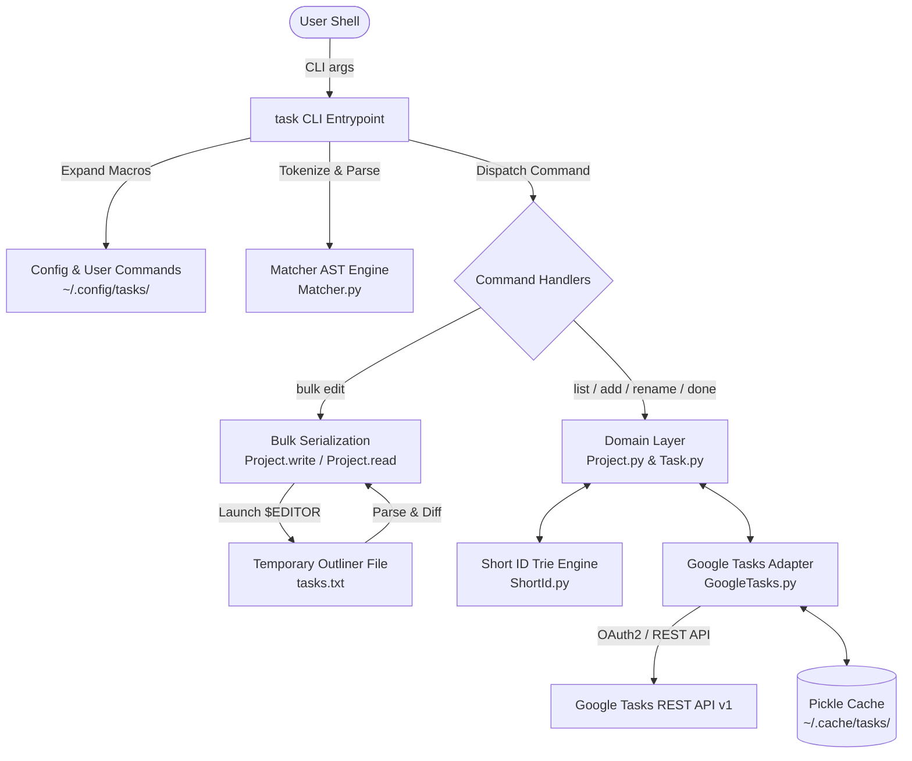
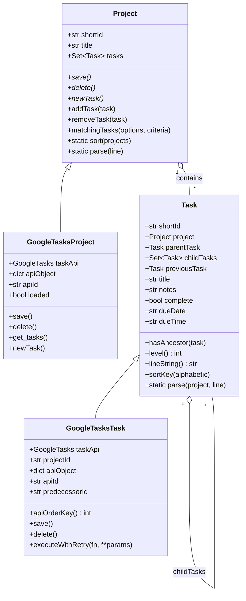
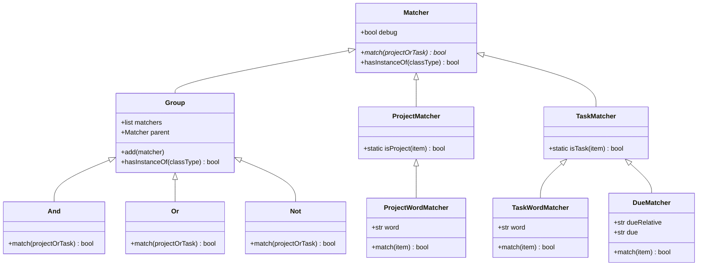
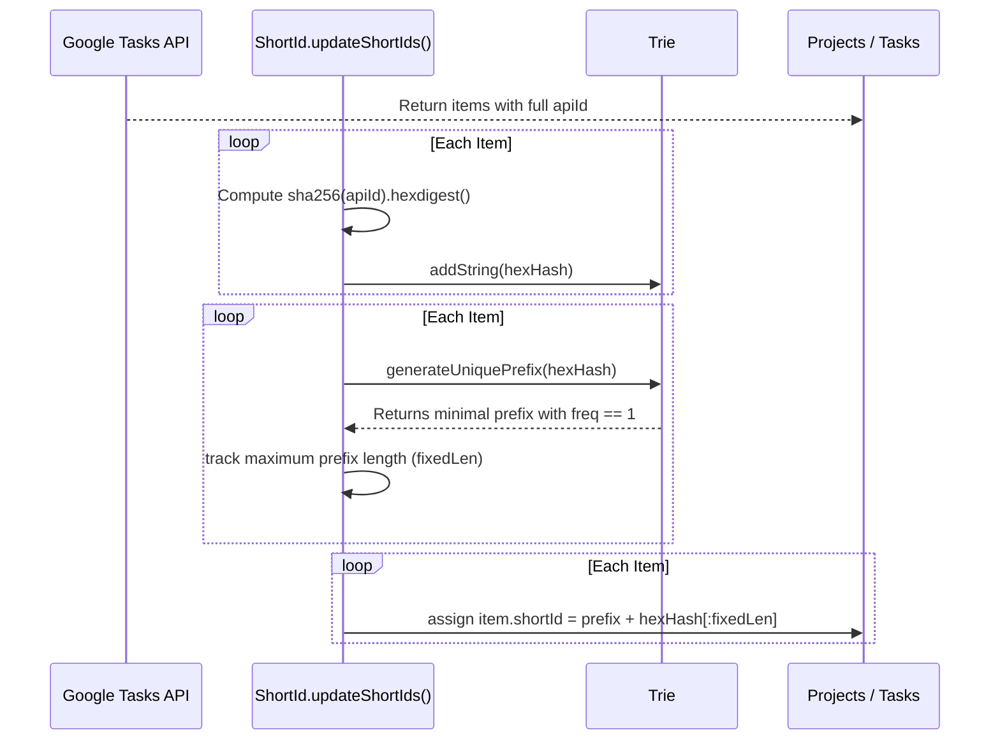

# Architecture & Technical Design Document: `task` CLI

**Project**: `task` — Command-Line Interface for Google Tasks  
**Author / Maintainer**: Philip Whineray  
**Document Target**: `agentic/design.md`  
**Status**: Production / Active  

---

## 1. Executive Summary & Overview

### 1.1 Purpose
The `task` project is a command-line productivity tool and task manager integrated with Google Tasks (Google Tasks API v1). It is optimized for keyboard-centric workflows, Getting Things Done (GTD) methodology, fast task capture, sophisticated query/filtering, and interactive two-way text-editor bulk manipulation.

### 1.2 Core Capabilities
- **Direct Task & Project Management**: Fast CLI creation, renaming, completion toggling, deletion, and listing of tasks and task lists ("projects").
- **Interactive Bulk Editing (`task bulk`)**: Serializes tasks and projects into an outliner-style text format, opens the user's preferred `$EDITOR` (e.g. `vi`, `nvim`), parses user-modified text upon save, and synchronizes creates, updates, moves, re-parentings, reorderings, and deletions back to Google Tasks.
- **Expressive Query Language**: Boolean algebra (`AND`, `OR`, `NOT`) combining keyword/regex searches, project scoping (`p:<project>`), tag matching (`@tag`), and relative/absolute due-date constraints (`d:today`, `d:+=YYYY-MM-DD`).
- **Short Identifier System (`ShortId`)**: Dynamically computes uniform, shortest unambiguous hex prefixes for Google Tasks' long base64 API identifiers using a SHA-256 trie.
- **Hierarchical Subtasks**: Native support for parent-child task relationships with tree-level indentation, ancestor navigation, and earliest-due-date sorting.
- **Multi-Account & Caching**: Supports multiple Google accounts via credential suffixing and caches task data locally in pickle format with timestamp-based cache invalidation.

---

## 2. High-Level Architecture

The system is organized into modular Python components separating CLI parsing, boolean criteria evaluation, domain modeling, short-ID generation, and Google API interactions:



### Component Breakdown
| Component | Primary File | Responsibilities |
| :--- | :--- | :--- |
| **CLI & Controller** | `task` | Argument parsing, macro expansion, command routing, interactive `$EDITOR` execution, user prompts. |
| **Domain Model** | `Project.py`, `Task.py` | Task and Project abstraction, hierarchical tree maintenance, outliner format serialization (`write`) and parsing (`read`). |
| **Query Engine** | `Matcher.py` | Composite AST nodes (`And`, `Or`, `Not`, `Group`) matching against projects and tasks. |
| **Google Tasks Adapter** | `GoogleTasks.py` | OAuth2 authentication, REST API communication (`tasklists`, `tasks`), retry logic, caching, API-to-domain mapping. |
| **Short ID Generator** | `ShortId.py` | SHA-256 hashing and Trie traversal to generate minimal collision-free prefixes (`pXX`, `tXXX`). |

---

## 3. Domain Model & Data Structures



### 3.1 Project (`Project.py`, `GoogleTasks.Project`)
- Represents a Google Tasks `taskList`.
- Maintains a set of associated `Task` objects (`self._tasks`).
- **Sorting Logic**: Special handling for standard GTD lists:
  - `Scheduled` is sorted first (`00-Scheduled`).
  - `Inbox` is sorted second (`01-Inbox`).
  - All other projects are sorted alphabetically (`99-<title>`).

### 3.2 Task (`Task.py`, `GoogleTasks.Task`)
- Represents a single task item within a project.
- **Hierarchy**:
  - `parentTask`: Reference to the parent `Task` (or `None` for top-level tasks).
  - `childTasks`: Set of immediate child `Task` instances.
  - `level()`: Computed depth in the hierarchy (0 for root, 1 for subtask, etc.).
- **Ordering**:
  - `previousTask`: Pointer to the immediately preceding sibling task.
  - `apiOrderKey()`: Extracted integer from the Google Tasks `position` field.
- **Hierarchical Earliest-Due Sorting**:
  `Task.sortKey()` builds a list of `(earliestDue, posKey)` tuples from the root of the hierarchy down to the task. If a child task has an earlier due date than its parent, that earliest date bubbles up to influence the parent's sort order.

---

## 4. Query Language & Filtering (`Matcher.py`)

The system implements a flexible command-line query expression parser evaluated against `Project` and `Task` objects.



### 4.1 Filter Criteria Syntax
- **Word / Regexp Matcher**: Plain strings match case-insensitively against task titles or short IDs (e.g. `task list groceries` or `task list t1a`).
- **Tag Matcher**: Tags written as `@tag` (e.g. `@na`, `@wait`, `@monitor`) match as substrings within the task title.
- **Project Matcher**: `p:<name>` or `project:<name>` restricts matches to specific project names or project short IDs.
- **Due Date Matcher**: `due:<spec>` or `d:<spec>`:
  - Exact date: `due:2026-11-04`, `due:today`, `due:now`.
  - Comparison operators:
    - `due:+2026-11-04` (strictly after).
    - `due:-2026-11-04` (strictly before).
    - `due:+=2026-11-04` or `due:=+2026-11-04` (on or after).
    - `due:-=2026-11-04` or `due:=-2026-11-04` (on or before).
- **Boolean Combinators**:
  - `OR` / `or`: Creates disjunctive groups.
  - `NOT` / `not`: Inverts the following matcher.
  - Default between words is `AND`.

---

## 5. Short Identifier System (`ShortId.py`)

Google Tasks assigns long base64/URL-safe strings for IDs (e.g. `MDEyMjgwODkxNTU0MzY1MTc3MzM6NTczOTUyOTIwODYxNDgxODow`). These are cumbersome in a CLI. `ShortId.py` solves this elegantly:



### Design Guarantees
1. **Uniqueness**: Prefix generation halts as soon as a Trie branch reaches a frequency count of 1.
2. **Visual Consistency**: All short IDs in a single run share the same character length (`fixedLen`), eliminating ragged columns.
3. **Prefix Separation**: Projects are prefixed with `p` (e.g. `pcd`, `pf9`); tasks are prefixed with `t` (e.g. `t7751ed`, `ta08307`).

---

## 6. Interactive Bulk Editing Engine (`task bulk`)

The flagship feature of the utility is two-way text-editor synchronization. Users edit plain text; the system translates text diffs into atomic Google Tasks REST API operations.

```mermaid
sequenceDiagram
    autonumber
    actor User
    participant CLI as task CLI
    participant File as /tmp/task-XXXX/tasks.txt
    participant Editor as $EDITOR (e.g. vi)
    participant Reader as Project.read()
    participant GAPI as Google Tasks API

    CLI->>File: Write header comments + Project.write()
    CLI->>Editor: subprocess.run([$EDITOR, taskFilePath])
    User->>Editor: Edit hierarchy, titles, dates, marks, reorders
    Editor-->>CLI: File saved & editor exits
    CLI->>Reader: Project.read(taskApi, infile)
    alt ParseError encountered
        Reader-->>CLI: Raise ParseError (e.g. invalid indent, bad date)
        CLI->>User: Display line error; "Press Enter to fix / Ctrl-C to abandon"
        CLI->>Editor: Re-launch $EDITOR on same file
    else Unexpected Exception
        CLI->>CLI: shutil.copy(taskFilePath, "tasks.saved")
        CLI->>User: Re-raise exception after saving recovery snapshot
    else Success
        Reader->>GAPI: Execute updates, inserts, moves, deletes
        CLI->>User: Complete
    end
```

### 6.1 Text Serialization Grammar
The serialization format closely mirrors Org-mode headings:
```text
* (p<id>) <Project Title>
** (t<id>) [<status>] [<due-date>] <Task Title>
*** (t<id>) [<status>] [<due-date>] <Subtask Title>
<Notes lines indented beneath task>
```

- **Level Indicator**: Asterisks `*` denote depth. A single `*` indicates a project header. `**` indicates a top-level task; `***` indicates a level-1 subtask, etc.
- **Identifier**: `(pXX)` or `(tXXX)`. Newly added items omit the ID or use `(p)` / `(t)`.
- **Status Box**:
  - `[ ]`: Incomplete (`needsAction`).
  - `[x]` or `[X]`: Completed.
  - `[-]`: Marked for deletion.
- **Due Date**: Optional ISO date bracketed as `[YYYY-MM-DD]`.
- **Notes**: Any non-heading lines directly underneath a task heading become its `notes` (when edited in verbose mode `-v`).
- **Project Deletion**: Marking project title as `-` (e.g. `* (p12) -`) queues the project for deletion (permitted only if all its tasks are deleted).

### 6.2 Reconciliation Algorithm (`Project.read`)
When parsing the edited buffer:
1. **Index Existing Records**: Maps existing projects and tasks by their `shortId`.
2. **Scan & Validate Line by Line**:
   - Detects indentation jumps: moving from depth $L$ to $L + k$ where $k > 1$ raises `ParseError`.
   - Prevents duplicate short IDs in the buffer.
   - Detects reparenting: resolves parent task by walking back up the indentation stack.
   - Computes predecessor tasks (`previousTask`) within each parent scope for sibling ordering.
3. **Change Detection**:
   - Compares titles, notes, due dates, completion states, and parent/predecessor pointers.
   - Handles project renames, project deletions, task deletions.
4. **Execution Order**:
   - `projectsToSave`: Updates or inserts projects.
   - `tasksToSave`: Updates, inserts, moves, and re-parents tasks.
   - `tasksToDelete`: Deletes tasks.
   - `projectsToDelete`: Deletes empty projects.

---

## 7. Google Tasks API Integration & Resilience

### 7.1 Authentication Lifecycle
- **OAuth2 Client ID**: Loaded from `~/.config/tasks/app-credentials.json`.
- **Pickled User Credentials**: Stored at `~/.config/tasks/user-token.pickle`.
- **Refresh Flow**: On startup, attempts token refresh via `google.auth.transport.requests.Request()`. If expired and refresh fails, triggers `InstalledAppFlow.from_client_secrets_file` running a local loopback web server for browser consent.
- **Multi-Account Support**: Invoking with `-A <AccountName>` appends `.<AccountName>` to both the app credentials and user token paths.

### 7.2 API Operations & Edge Cases
| Operation | REST Endpoint | Special Handling |
| :--- | :--- | :--- |
| **Fetch TaskLists** | `tasklists().list(maxResults=100)` | Handles pagination via `nextPageToken`. |
| **Fetch Tasks** | `tasks().list(tasklist=..., showHidden=True, showCompleted=True)` | Cached locally; paginated. |
| **Reorder / Reparent** | `tasks().move(tasklist=..., task=..., parent=..., previous=...)` | Uses `move` endpoint specifying new parent and immediate predecessor sibling. |
| **Cross-List Move** | `insert` in target list + `delete` from old list | Google Tasks API v1 does not support moving tasks between lists. Emulated by re-inserting and deleting original. |
| **Time/Recurrence Warning** | Standard `tasks().update()` | Google Tasks API v1 drops task times and repetition rules when updating `due`. The system detects when an existing `due` is modified and logs a warning to `sys.stderr`. |

### 7.3 Resilience: `executeWithRetry`
All modifying API calls are wrapped in an exponential/linear backoff loop (`maxRetry = 10`):
```python
while retriesRemaining:
    retriesRemaining -= 1
    try:
        result = fn(**params).execute()
        lastException = None
    except Exception as e:
        lastException = e
        time.sleep(maxRetry - retriesRemaining)
    else:
        break
```

### 7.4 Caching Architecture
- Cache storage directory: `~/.cache/tasks/`.
- Project cache: `project-<projectId>.pickle`.
- Tasks cache: `tasks-<projectId>.pickle`.
- **Validation**: On reading tasks, checks if cached project `updated` timestamp is $\ge$ the latest `updated` timestamp from the server. If fresh, reads directly from disk, saving seconds of network overhead on large task lists.
- **Invalidation**: Any mutating operation on a project or task calls `invalidateProjectCache(projectId)` to unlink both pickle files.

---

## 8. CLI Interface & Configuration

### 8.1 Filesystem Layout
```text
~/.config/tasks/
├── app-credentials.json          # OAuth2 client secrets (required)
├── app-credentials.json.<Acct>   # Secondary account OAuth2 client secrets
├── user-token.pickle             # Serialized Google OAuth2 credentials
├── user-defined-commands         # Custom macro definitions (key + args)
├── default-add-project           # Name of fallback project for new tasks (e.g. "Inbox")
└── bulk-edit-extension           # Temporary file extension (e.g. "txt" or "org"; fallback: bulk-edit-extenstion)

~/.cache/tasks/
├── project-<id>.pickle           # Serialized Project API cache
└── tasks-<id>.pickle             # Serialized Tasks API cache
```

### 8.2 Command Line Options & Commands
```text
Usage: task COMMAND [OPTION...] WORDS...

COMMANDS:
  list (ls)               List tasks matching criteria
  add                     Add a new task (defaults to default-add-project)
  rename (mv)             Rename a single task
  done                    Mark matching task as complete
  undo                    Mark matching completed task as incomplete
  delete (rm, del)        Delete matching task
  edit                    [Stubbed] Edit task
  bulk                    Interactive full-buffer bulk edit
  project-add             Add a new task list
  project-list (project-ls) List all task lists
  project-rename          Rename a task list
  project-delete          Delete a task list

OPTIONS:
  -P, -p                  Operate at project level
  -f                      Force action without interactive confirmation
  -v                      Verbose (include task notes)
  -a                      All (include completed tasks)
  -A <acct>               Use alternate account configuration
  -z                      Debug output
  -zm                     Debug query matching engine
  --                      Stop matcher processing (treat subsequent args as literals)
```

---

## 9. Comprehensive Code Audit & Technical Debt

During our deep review of the codebase, several critical bugs, anomalies, and architectural limitations were identified:

### 9.1 High-Severity Bugs & Code Defects (Remediated)
1. **`Project.py:28` — `removeTask` adds instead of removing** *(FIXED)*:
   ```python
   def removeTask( self, task ):
      self._tasks.remove( task )
   ```
   *Impact & Fix*: Previously called `self._tasks.add( task )`. When moving a task from one project to another via `Task.set_project`, the old project retained the task in its `_tasks` set, causing phantom duplicates in memory. Fixed to call `self._tasks.remove( task )`.

2. **`Project.py:186` — Unbound variable `project` in `read()`** *(FIXED)*:
   ```python
   original = taskById.get( task.shortId )
   if not original:
      original = currentProject.newTask()
   ```
   *Impact & Fix*: Previously called `project.newTask()` where `project` was a leaked loop variable from a prior iteration over all projects (or unbound if projects was empty). Adding a brand-new task during `task bulk` erroneously added the task to the last project or crashed with `UnboundLocalError`. Fixed to call `currentProject.newTask()`.

3. **`task:277` — Dead code in `doTaskAdd`** *(FIXED)*:
   ```python
   def doTaskAdd( taskApi, options, criteria, words, args ):
      if criteria.hasInstanceOf( Task.TaskMatcher ):
         raise RuntimeError( "Cannot use task criteria with this action" )
      project = getMatchingProject( taskApi, options, criteria )
      task = project.newTask()
      task.title = " ".join( words )
      task.save()
   ```
   *Impact & Fix*: Previously allocated `projectCriteria = [ Project.WordMatcher( "inbox" ) ]` but never added it to `criteria` or referenced it again. Default project selection is already handled via `loadDefaultAddProject` in `main()`. Dead code removed.

4. **`task:63` — Typo in configuration filename** *(FIXED)*:
   ```python
   bulkEditFileExtensionFile = "/bulk-edit-extension"
   bulkEditFileExtensionFallbackFile = "/bulk-edit-extenstion"
   ```
   *Impact & Fix*: Filename contained a typo (`extenstion`). Corrected to `bulk-edit-extension` with fallback support for the legacy `bulk-edit-extenstion` path in `loadBulkEditFileExtension()` to ensure seamless backward compatibility.

### 9.2 Missing Implementations / Stubs
- `doTaskEdit` (`task:293`): Raises `NotImplementedError("doTasksEdit")`.
- `doTaskTag` (`task:297`): Raises `NotImplementedError("doTasksTag")`.

### 9.3 Architectural Observations
- **API v1 Limitations**: Google Tasks API does not expose recurrence rules or time of day. Updating a due date via API v1 will silently clear any repetition or specific time set via Google Calendar/Web.
- **Cross-List Moves**: Moving tasks across task lists requires creating a new task and deleting the old one. This causes the task to receive a new Google Tasks ID, breaking any external URL deep links or references.
- **Cache Thread Safety / Process Safety**: File caching relies on direct unpickling and whole-file deletion without file locks. Running concurrent instances of `task` against the same cache directory may result in race conditions.

---

## 10. Future Recommendations & Roadmap

1. **Bug Remediation**:
   - [x] Fix `Project.removeTask()` to call `self._tasks.remove(task)`.
   - [x] Fix `Project.read()` line 186 to use `currentProject.newTask()`.
   - [x] Clean up dead code in `doTaskAdd()`.
   - [x] Provide alias fallback for `bulk-edit-extenstion` $\rightarrow$ `bulk-edit-extension`.
2. **Complete Stubbed Commands**:
   - Implement `task edit`: open a temporary buffer with just the selected task's title, notes, and due date.
   - Implement `task tag`: add or remove tags from task titles (`@tag` and `@-tag`).
3. **Type Annotations & Modernization**:
   - Add PEP 484 type hints throughout `Task.py`, `Project.py`, and `Matcher.py`.
   - Modernize from `pickle` to structured JSON or SQLite for cached task data to improve inspection, debugging, and migration resilience.
4. **Automated Test Harness**:
   - Unit tests covering `Project`, `Task`, `Project.read()`, `doTaskAdd()`, and configuration loading have been implemented in `tests/test_project.py` and `tests/test_task_cli.py`.
   - Implement unit tests for `Matcher.py` and `ShortId.py`.
   - Create mock API fixtures for `Project.write()` and `Project.read()` to verify bulk editing without requiring live Google OAuth credentials.
