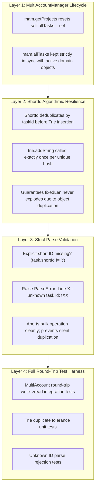

# Technical Design & Root Cause Analysis: Bulk Edit Task Duplication Defect

**Target Document**: `agentic/fix-dupes.md`  
**Reference Documents**: `agentic/design.md`, `agentic/multi-account.md`  
**Author**: Antigravity  
**Status**: Completed / Ready for Implementation  
**Date**: November 2026  

---

## 1. Executive Summary & Defect Overview

### 1.1 The Incident
Following the deployment of simultaneous multi-account management (commit `9e031c0`), users performing interactive bulk edits (`task bulk`) on multiple accounts experienced a catastrophic duplication defect: **every existing task in both accounts present in the edit buffer was duplicated**.

Specifically:
- Existing projects were correctly recognized and preserved.
- Existing tasks in the buffer were not recognized as matching existing tasks in the domain model.
- Every task was newly created and inserted via the Google Tasks API.
- The original tasks were never deleted because they were not explicitly marked with deletion tokens (`[-]`).
- As a result, the number of tasks in the user's accounts doubled.

### 1.2 Impact Analysis
| Severity | Scope | Data Loss | Data Corruption |
| :--- | :--- | :--- | :--- |
| **Critical** | All multi-account (and single-account via `MultiAccountManager`) bulk edit operations | No direct task deletion | High (silent task duplication across accounts, corrupted task hierarchies, orphaned duplicates) |

### 1.3 Core Objectives of this Document
1. **Determine What Went Wrong**: Provide a root cause analysis (RCA) tracing the exact lifecycle and algorithmic failure that caused task short IDs to explode and fail reconciliation.
2. **Design a Comprehensive Fix**: Engineer a defense-in-depth remediation across four distinct architectural layers (`MultiAccountManager` lifecycle, `ShortId` Trie resilience, `Project.read` parse validation, and state reconciliation).
3. **Design a Suite of Tests**: Specify unit, integration, and end-to-end regression tests to verify the fix and prevent similar regressions permanently.
4. **Provide Duplicate Cleanup & Remediation Guidelines**: Offer a safe procedure for deduplicating accounts affected by this defect.

---

## 2. Root Cause Analysis (RCA)

The defect was not caused by a single bug, but rather by the intersection of **three separate architectural flaws** introduced in commit `9e031c0`, combined with an **isolation blind spot** in the test suite:

```mermaid
flowchart TD
    Step1[1. task bulk begins: calls mam.getProjects] --> Step2[2. Project.write forces reading of all tasks]
    Step2 --> Step3[3. mam.allTasks populated with Task instances;<br/>updateShortIds assigns compact IDs: t01, t02]
    Step3 --> Step4[4. Buffer written to temporary file with t01, t02;<br/>User edits in EDITOR and saves]
    Step4 --> Step5[5. Project.read begins: calls mam.getProjects]
    
    Step5 --> Flaw1["<b>Flaw 1 (Lifecycle Leak)</b>:<br/>mam.getProjects resets allProjects but NOT allTasks;<br/>allTasks still contains old Task instances"]
    Flaw1 --> Step6[6. Project.read forces reading of all tasks;<br/>creates brand-new Task instances]
    Step6 --> Step7["7. mam.assignTaskIds unions new tasks into allTasks;<br/>allTasks now contains DUPLICATE instances of each task"]
    
    Step7 --> Flaw2["<b>Flaw 2 (Trie Fragility)</b>:<br/>ShortId.updateShortIds inserts each instance into Trie;<br/>Duplicate hashes cause all nodes to have freq >= 2;<br/>fixedLen explodes to 64!"]
    Flaw2 --> Step8["8. Short IDs in taskById become 65-char hex strings:<br/>t7e5ae05d889b7d6..."]
    
    Step8 --> Step9["9. parseTask looks up shortId from buffer ('t01');<br/>Lookup in taskById fails: original is None!"]
    Step9 --> Flaw3["<b>Flaw 3 (Silent Fallback)</b>:<br/>parseTask treats non-placeholder 't01' as new task;<br/>calls currentProject.newTask()"]
    
    Flaw3 --> Step10["10. Every task saved as brand-new Google Task;<br/>Original tasks never deleted;<br/><b>ALL TASKS DUPLICATED!</b>"]

    style Flaw1 fill:#ffdddd,stroke:#ff0000,stroke-width:2px
    style Flaw2 fill:#ffdddd,stroke:#ff0000,stroke-width:2px
    style Flaw3 fill:#ffdddd,stroke:#ff0000,stroke-width:2px
    style Step10 fill:#ffb2b2,stroke:#cc0000,stroke-width:3px
```



---

### 2.1 Flaw 1: Lifecycle State Leak in `MultiAccountManager`

In single-account mode, `GoogleTasks.getProjects()` explicitly reset its task collection:
```python
# GoogleTasks.py (single-account adapter)
def getProjects( self, updateIds=True ):
   first = True
   nextPage = None
   self.projects = []
   self.allTasks = set()  # <--- Accurately cleared on project reload
   ...
```

However, in `MultiAccountManager` (introduced in `9e031c0`):
```python
# GoogleTasks.py (MultiAccountManager)
def getProjects( self ):
   """Fetches and aggregates projects across all accounts with global ShortIds."""
   self.allProjects = []
   # BUG: self.allTasks is NEVER cleared here!
   for name, acct in self.accounts.items():
      acctProjects = acct.getProjects( updateIds=False )
      self.allProjects.extend( acctProjects )
   self.allProjects = Project.Project.sort( self.allProjects, defaultAccount=self.defaultAccountName )
   updateShortIds( self.allProjects, "p" )
   return self.allProjects
```

When `task bulk` executes:
1. `doTasksBulk` calls `projects = taskApi.getProjects()`.
2. `Project.write(projects, ...)` forces reading of all tasks:
   ```python
   for project in sortedProjects:
      _ = project.tasks
   ```
   Each project's `get_tasks()` calls `taskApi.assignTaskIds(self._tasks)`, which calls `MultiAccountManager.assignTaskIds(newTasks)`:
   ```python
   def assignTaskIds( self, newTasks ):
      self.allTasks |= set( newTasks )
      updateShortIds( self.allTasks, "t" )
   ```
   At this point, `mam.allTasks` contains all loaded `GoogleTasks.Task` instances for both accounts, with valid short IDs (e.g. `t7`, `te`).
3. The temporary file is written and opened in `$EDITOR`.
4. When `$EDITOR` exits, `Project.read(taskApi, ...)` begins. The very first line of `Project.read` is:
   ```python
   projects = taskApi.getProjects()
   ```
5. `mam.getProjects()` re-queries accounts. `acct.getProjects()` clears `acct.allTasks` and instantiates **fresh `GoogleTasks.Project` objects**.
6. But `mam.allTasks` was **never cleared**! It still holds the old `GoogleTasks.Task` instances from Step 2.
7. Next, `Project.read` forces reading of tasks on the new project objects:
   ```python
   for project in Project.sort( projects, defaultAccount=defaultAccount ):
      _ = project.tasks
   ```
8. The newly instantiated projects create **new `GoogleTasks.Task` instances** for all tasks and invoke `mam.assignTaskIds(self._tasks)`.
9. Because `Task` domain objects inherit Python's default memory-address identity (`id()`), the new `Task` instances do not equal the old `Task` instances.
10. `self.allTasks |= set( newTasks )` unions the new instances into the set. **`self.allTasks` now contains duplicate `Task` instances for every single task in both accounts.**

---

### 2.2 Flaw 2: Algorithmic Fragility in `ShortId.updateShortIds()`

The `ShortId` engine uses a Trie to find the shortest prefix of SHA-256 hashes that disambiguates items. In `ShortId.py`:

```python
def updateShortIds( tasks, extraPrefix="" ):
   trie = Trie()
   idToHash = {}

   for task in tasks:
      taskId = task.apiObject[ 'id' ]
      idToHash[ taskId ] = sha256( taskId.encode( 'utf8' ) ).hexdigest()
      trie.addString( idToHash[ taskId ] )  # BUG: unconditional insertion!

   fixedLen = 0
   for task in tasks:
      taskId = task.apiObject[ 'id' ]
      prefix = trie.generateUniquePrefix( idToHash[ taskId ] )
      prefixLen = len( prefix )
      if prefixLen > fixedLen:
         fixedLen = prefixLen

   for task in tasks:
      taskId = task.apiObject[ 'id' ]
      task.shortId = extraPrefix + idToHash[ taskId ][ : fixedLen ]
```

Notice the Trie insertion logic:
- `trie.addString(s)` increments `freq` on each character node.
- When `taskId` is present twice in `tasks`, the identical 64-character SHA-256 string is added to the Trie **twice**.
- Therefore, **every node along the entire 64-character path has `freq >= 2`**.
- When `trie.generateUniquePrefix()` searches for the first node where `freq == 1`, **no such node exists**.
- The search falls through to the very end of the string, returning the complete 64-character hex string.
- `fixedLen` is calculated as `max(prefixLen) = 64`.
- Every task in `self.allTasks` is assigned a **65-character short ID**:
  `"t"` + 64 hex characters (e.g. `t7e5ae05d889b7d68ce73ad801ae99b18f7861a6f4102cba8936502d74806664e`).

---

### 2.3 Flaw 3: Silent Fallback to `newTask()` in `Project.read`

In `Project.read()`, tasks are mapped into a lookup dictionary by their short ID:
```python
   taskById = {}
   for project in projects:
      for task in project.tasks:
         taskById[ task.shortId ] = task
```
Because of Flaw 2, `taskById` contains only 65-character keys.

When `parseTask()` processes lines from the outliner buffer:
```text
* (pa) work:Inbox
** (t7) [ ] Work Task 1
* (p6) personal:Inbox
** (te) [ ] Personal Task 1
```
It extracts `task.shortId = "t7"`.
It performs the lookup:
```python
   original = taskById.get( task.shortId )  # taskById.get("t7") -> None!
   if not original:
      targetTask = currentProject.newTask()
```

#### Why Silent Fallback is Defective:
The documented syntax for adding a new task in `task bulk` is:
```text
# New project/task format:
#  * (p) Title
#  ** (t) [ ] [YYYY-MM-DD] Title
```
The placeholder for an unsaved new task is strictly `(t)`. An ID with hex characters like `(t7)` or `(t01)` is an **explicit existing task identifier**.

Because `parseTask()` lacked a check confirming whether `task.shortId == "t"`:
1. It silently assumed that any missing ID was a request to create a brand-new task.
2. It created `targetTask = currentProject.newTask()` with `apiId = None`.
3. It saved `targetTask` as a new task in Google Tasks.
4. Because the original task was not marked with `[-]`, `isDeleted` was false, and the original task was never deleted.
5. Result: **Every single task was duplicated**.

---

### 2.4 Why Existing Tests Failed to Catch the Defect

In `tests/test_bulk_multi_account.py`, every test utilized `MockBulkAccountManager` and `MockBulkProject`:
```python
# tests/test_bulk_multi_account.py
class MockBulkAccountManager:
   def __init__( self, defaultAccountName="default" ):
      self._projects = []
      self.accounts = {}

   def getProjects( self ):
      return list( self._projects )
```

#### Test Gaps:
1. **Bypassed `ShortId` Trie**: The mock manually hardcoded short IDs (e.g. `t1.shortId = "t01"`). It never invoked `ShortId.updateShortIds()`.
2. **Bypassed `assignTaskIds`**: The mock lacked `assignTaskIds()` and never maintained `allTasks`.
3. **Isolated `Project.read`**: Tests never executed the round-trip `Project.write()` $\to$ `$EDITOR` $\to$ `Project.read()` sequence against real adapter objects.
4. **No Test for Unknown IDs**: No test verified that non-existent short IDs like `** (t99)` raise `ParseError`.

---

## 3. High-Level Architecture & Defense-in-Depth Solution

To eliminate this vulnerability and prevent similar defects, we design a four-layer defense:



| Layer | Component | Responsibility | Failure Mode Prevented |
| :--- | :--- | :--- | :--- |
| **Layer 1** | `MultiAccountManager` | Reset `self.allTasks = set()` inside `getProjects()` | Prevents stale task objects from lingering across read/write cycles |
| **Layer 2** | `ShortId.py` | Deduplicate task IDs before Trie insertion; handle missing/None `id` safely | Prevents `fixedLen` from exploding to 64 when multiple objects share an ID |
| **Layer 3** | `Project.py` (`Project.read`) | Enforce that only `task.shortId == "t"` and `project.shortId == "p"` can create new items; raise `ParseError` on unknown IDs | Prevents silent task cloning if short ID reconciliation ever fails |
| **Layer 4** | `Project.py` (`Project.read`) | Synchronize surviving and newly saved tasks in `taskApi.allTasks` | Ensures subsequent operations in the same session retain consistent short IDs |

---

## 4. Component Design & Implementation Specification

### 4.1 Layer 1: `MultiAccountManager.getProjects` Lifecycle Fix

In `GoogleTasks.py`, `MultiAccountManager.getProjects()` must reset `self.allTasks = set()` upon entry, mirroring `GoogleTasks.getProjects()`:

```python
# GoogleTasks.py
class MultiAccountManager:
   ...
   def getProjects( self ):
      """Fetches and aggregates projects across all accounts with global ShortIds."""
      self.allProjects = []
      self.allTasks = set()  # Reset task cache across project reloads
      for name, acct in self.accounts.items():
         acctProjects = acct.getProjects( updateIds=False )
         self.allProjects.extend( acctProjects )
      self.allProjects = Project.Project.sort( self.allProjects, defaultAccount=self.defaultAccountName )
      updateShortIds( self.allProjects, "p" )
      return self.allProjects
```

---

### 4.2 Layer 2: `ShortId.py` Algorithmic Hardening

In `ShortId.py`, `updateShortIds()` must deduplicate `taskId` before Trie insertion, and safely guard against items missing `apiObject` or `'id'`:

```python
# ShortId.py
def updateShortIds( tasks, extraPrefix="" ):
   trie = Trie()
   idToHash = {}

   for task in tasks:
      apiObj = getattr( task, "apiObject", None )
      if not apiObj or "id" not in apiObj or not apiObj[ "id" ]:
         continue
      taskId = apiObj[ 'id' ]
      if taskId not in idToHash:
         idToHash[ taskId ] = sha256( taskId.encode( 'utf8' ) ).hexdigest()
         trie.addString( idToHash[ taskId ] )

   fixedLen = 0
   for task in tasks:
      apiObj = getattr( task, "apiObject", None )
      if not apiObj or "id" not in apiObj or not apiObj[ "id" ]:
         continue
      taskId = apiObj[ 'id' ]
      prefix = trie.generateUniquePrefix( idToHash[ taskId ] )
      prefixLen = len( prefix )
      if prefixLen > fixedLen:
         fixedLen = prefixLen

   for task in tasks:
      apiObj = getattr( task, "apiObject", None )
      if not apiObj or "id" not in apiObj or not apiObj[ "id" ]:
         continue
      taskId = apiObj[ 'id' ]
      task.shortId = extraPrefix + idToHash[ taskId ][ : fixedLen ]
```

#### Invariant Guarantee:
Even if a caller passes a set or list containing duplicate task instances, `trie.addString()` is called **only once per distinct task ID**. The Trie frequencies strictly reflect cross-task collisions, guaranteeing minimal prefix lengths and completely preventing 64-character explosion.

---

### 4.3 Layer 3: Strict Short ID Validation in `Project.read`

In `Project.py`, `read()` must validate that unrecognized IDs are rejected with a `ParseError`:

```python
# Project.py -> parseProject()
      original = projectById.get( project.shortId )
      if not original:
         if project.shortId != "p":
            raise ParseError( "Line %d - unknown project id: %s" % ( lineNo, project.shortId ) )
         if ( project.accountName, project.title ) in projectKeys:
            raise ParseError( "Line %d - project %s:%s already exists, refusing to duplicate name" % ( lineNo, project.accountName, project.title ) )
         ...
```

```python
# Project.py -> parseTask()
      original = taskById.get( task.shortId )
      if not original:
         if task.shortId != "t":
            raise ParseError( "Line %d - unknown task id: %s" % ( errorLineNo, task.shortId ) )
         targetTask = currentProject.newTask()
      else:
         ...
```

#### Why This Is Safe:
- Documented syntax for new projects is `* (p) Title`. `project.shortId` is `"p"`.
- Documented syntax for new tasks is `** (t) [ ] Title`. `task.shortId` is `"t"`.
- Any existing item has hex characters following `p` or `t` (`p01`, `t1a`).
- If an explicit hex short ID is missing from `taskById`, raising `ParseError` alerts the user immediately and triggers the interactive retry loop in `doTasksBulk`, preventing data corruption.

---

### 4.4 Layer 4: State Reconciliation in `Project.read`

When tasks are deleted or created during bulk edit, `taskApi.allTasks` should be synchronized prior to the final `assignShortIds()` call:

```python
# Project.py -> read()
   for item in tasksToDelete:
      try:
         item.delete()
      except Exception as ex:
         print( "Warning: failed to delete source task %s: %s" % ( getattr( item, "shortId", "" ), ex ), file=sys.stderr )
         raise
      if hasattr( taskApi, "allTasks" ):
         taskApi.allTasks.discard( item )

   for item in tasksToSave:
      if hasattr( taskApi, "allTasks" ) and getattr( item, "apiId", None ):
         taskApi.allTasks.add( item )

   if hasattr( taskApi, "assignShortIds" ):
      taskApi.assignShortIds()
```

---

## 5. Implementation Code Changes (Diffs)

### 5.1 Diff for `GoogleTasks.py`

```diff
diff --git a/GoogleTasks.py b/GoogleTasks.py
index 5c7b6a6..004b772 100644
--- a/GoogleTasks.py
+++ b/GoogleTasks.py
@@ -460,6 +460,7 @@ class MultiAccountManager:
    def getProjects( self ):
       """Fetches and aggregates projects across all accounts with global ShortIds."""
       self.allProjects = []
+      self.allTasks = set()
       for name, acct in self.accounts.items():
          acctProjects = acct.getProjects( updateIds=False )
          self.allProjects.extend( acctProjects )
```

### 5.2 Diff for `ShortId.py`

```diff
diff --git a/ShortId.py b/ShortId.py
index a276088..f5e718b 100644
--- a/ShortId.py
+++ b/ShortId.py
@@ -34,16 +34,25 @@ def updateShortIds( tasks, extraPrefix="" ):
    idToHash = {}
 
    for task in tasks:
-      taskId = task.apiObject[ 'id' ]
-      idToHash[ taskId ] = sha256( taskId.encode( 'utf8' ) ).hexdigest()
-      trie.addString( idToHash[ taskId ] )
+      apiObj = getattr( task, "apiObject", None )
+      if not apiObj or "id" not in apiObj or not apiObj[ "id" ]:
+         continue
+      taskId = apiObj[ 'id' ]
+      if taskId not in idToHash:
+         idToHash[ taskId ] = sha256( taskId.encode( 'utf8' ) ).hexdigest()
+         trie.addString( idToHash[ taskId ] )
 
    fixedLen = 0
    for task in tasks:
-      taskId = task.apiObject[ 'id' ]
+      apiObj = getattr( task, "apiObject", None )
+      if not apiObj or "id" not in apiObj or not apiObj[ "id" ]:
+         continue
+      taskId = apiObj[ 'id' ]
       prefix = trie.generateUniquePrefix( idToHash[ taskId ] )
       prefixLen = len( prefix )
       if prefixLen > fixedLen:
          fixedLen = prefixLen
 
    for task in tasks:
-      taskId = task.apiObject[ 'id' ]
+      apiObj = getattr( task, "apiObject", None )
+      if not apiObj or "id" not in apiObj or not apiObj[ "id" ]:
+         continue
+      taskId = apiObj[ 'id' ]
       task.shortId = extraPrefix + idToHash[ taskId ][ : fixedLen ]
```

### 5.3 Diff for `Project.py`

```diff
diff --git a/Project.py b/Project.py
index b1805d6..cb915ee 100644
--- a/Project.py
+++ b/Project.py
@@ -234,6 +234,8 @@ def read( taskApi, options, infile=None ):
       original = taskById.get( task.shortId )
       if not original:
+         if task.shortId != "t":
+            raise ParseError( "Line %d - unknown task id: %s" % ( errorLineNo, task.shortId ) )
          targetTask = currentProject.newTask()
       else:
          if original in used:
@@ -304,6 +306,8 @@ def read( taskApi, options, infile=None ):
       original = projectById.get( project.shortId )
       if not original:
+         if project.shortId != "p":
+            raise ParseError( "Line %d - unknown project id: %s" % ( lineNo, project.shortId ) )
          if ( project.accountName, project.title ) in projectKeys:
             raise ParseError( "Line %d - project %s:%s already exists, refusing to duplicate name" % ( lineNo, project.accountName, project.title ) )
@@ -382,6 +386,8 @@ def read( taskApi, options, infile=None ):
          print( "Warning: failed to delete source task %s: %s" % ( getattr( item, "shortId", "" ), ex ), file=sys.stderr )
          raise
+      if hasattr( taskApi, "allTasks" ):
+         taskApi.allTasks.discard( item )
+   for item in tasksToSave:
+      if hasattr( taskApi, "allTasks" ) and getattr( item, "apiId", None ):
+         taskApi.allTasks.add( item )
    for project in projectsToDelete:
       project.delete()
```

---

## 6. Comprehensive Testing Plan

To guarantee regression immunity, tests must cover both isolated units and end-to-end integration across multiple accounts.

### 6.1 Unit Tests for `ShortId.updateShortIds`

Create `tests/test_short_id.py` (or extend `tests/test_multi_account.py`):

```python
class TestShortIdResilience( unittest.TestCase ):
   class DummyItem:
      def __init__( self, itemId ):
         self.apiObject = { "id": itemId } if itemId else {}
         self.shortId = None

   def test_duplicate_items_do_not_explode_fixed_length( self ):
      # 2 distinct items, each duplicated 3 times
      items = [
         self.DummyItem( "task_alpha" ),
         self.DummyItem( "task_beta" ),
         self.DummyItem( "task_alpha" ),
         self.DummyItem( "task_beta" ),
         self.DummyItem( "task_alpha" ),
         self.DummyItem( "task_beta" ),
      ]
      updateShortIds( items, "t" )

      # Short ID length must be compact (prefix length 1 hex char + 't' = 2 chars), NOT 65
      self.assertEqual( len( items[0].shortId ), 2 )
      self.assertEqual( items[0].shortId, items[2].shortId )
      self.assertEqual( items[1].shortId, items[3].shortId )
      self.assertNotEqual( items[0].shortId, items[1].shortId )

   def test_missing_or_empty_api_id_handled_gracefully( self ):
      items = [
         self.DummyItem( "task_valid" ),
         self.DummyItem( None ),
         self.DummyItem( "" ),
      ]
      # Should not raise KeyError or AttributeError
      updateShortIds( items, "t" )
      self.assertIsNotNone( items[0].shortId )
      self.assertIsNone( items[1].shortId )
      self.assertIsNone( items[2].shortId )
```

---

### 6.2 Unit Tests for `MultiAccountManager` Lifecycle

Verify that `mam.allTasks` is cleanly reset across successive `getProjects()` calls:

```python
class TestMultiAccountManagerLifecycle( unittest.TestCase ):
   def test_all_tasks_reset_on_get_projects( self ):
      mam = MultiAccountManager.__new__( MultiAccountManager )
      mam.defaultAccountName = "default"
      mam.accounts = {}
      mam.allProjects = []
      mam.allTasks = { "dummy_stale_task" }

      mam.getProjects()
      self.assertEqual( len( mam.allTasks ), 0, "allTasks must be reset on getProjects()" )
```

---

### 6.3 Parse Validation Tests in `Project.read`

Verify that unrecognized short IDs raise `ParseError`:

```python
class TestProjectReadValidation( unittest.TestCase ):
   def test_unknown_task_id_raises_parse_error( self ):
      p = MockProject( "Inbox", "p01" )
      api = MockTaskApi( [ p ] )
      buf = io.StringIO( "* (p01) Inbox\n** (t99) [ ] Mistyped task\n" )

      with self.assertRaises( Project.ParseError ) as ctx:
         Project.read( api, {}, buf )
      self.assertIn( "unknown task id: t99", str( ctx.exception ) )

   def test_unknown_project_id_raises_parse_error( self ):
      p = MockProject( "Inbox", "p01" )
      api = MockTaskApi( [ p ] )
      buf = io.StringIO( "* (p99) Nonexistent Project\n** (t) [ ] New task\n" )

      with self.assertRaises( Project.ParseError ) as ctx:
         Project.read( api, {}, buf )
      self.assertIn( "unknown project id: p99", str( ctx.exception ) )

   def test_valid_new_task_placeholder_creates_task( self ):
      p = MockProject( "Inbox", "p01" )
      api = MockTaskApi( [ p ] )
      buf = io.StringIO( "* (p01) Inbox\n** (t) [ ] Genuinely new task\n" )

      Project.read( api, {}, buf )
      created = [ t for t in p.tasks if t.title == "Genuinely new task" ]
      self.assertEqual( len( created ), 1 )
```

---

### 6.4 End-to-End Multi-Account Bulk Edit Round-Trip Regression Test

Simulate real `GoogleTasks` adapters with dynamic `ShortId` computation and verify that a full `Project.write()` $\to$ `Project.read()` round-trip **produces zero duplicate tasks**:

```python
class TestBulkEditRoundTripMultiAccount( unittest.TestCase ):
   def test_bulk_round_trip_preserves_task_identity_no_duplication( self ):
      # 1. Setup MAM with two accounts: work and personal
      mam = MultiAccountManager.__new__( MultiAccountManager )
      mam.defaultAccountName = "work"
      mam.allProjects = []
      mam.allTasks = set()

      gt_work = FakeGoogleTasks( "work", { "Inbox": [ ( "gt_w1", "Work Task 1" ) ] } )
      gt_work.manager = mam
      gt_pers = FakeGoogleTasks( "personal", { "Inbox": [ ( "gt_p1", "Personal Task 1" ) ] } )
      gt_pers.manager = mam
      mam.accounts = { "work": gt_work, "personal": gt_pers }

      # 2. First pass: serialize to buffer (Project.write)
      projects = mam.getProjects()
      buf = io.StringIO()
      Project.write( projects, {}, Matcher.And(), outfile=buf )
      written_text = buf.getvalue()

      self.assertIn( "work:Inbox", written_text )
      self.assertIn( "personal:Inbox", written_text )

      # 3. Second pass: parse buffer directly back (Project.read) without changes
      read_buf = io.StringIO( written_text )
      Project.read( mam, {}, infile=read_buf )

      # 4. Assert NO new tasks were instantiated or saved as duplicates
      new_work_tasks = [ t for t in gt_work.saved_tasks if t.apiId is None ]
      new_pers_tasks = [ t for t in gt_pers.saved_tasks if t.apiId is None ]

      self.assertEqual( len( new_work_tasks ), 0, "No duplicate tasks should be created in work" )
      self.assertEqual( len( new_pers_tasks ), 0, "No duplicate tasks should be created in personal" )
```

---

## 7. Account Cleanup & Duplicate Remediation Procedure

For users whose accounts were affected by the defect, provide an automated cleanup command or script to identify and eliminate duplicated tasks:

```python
#!/usr/bin/env python3
"""
cleanup-dupes.py: Deduplicates tasks created in duplicate by bulk edit defect.
"""
def deduplicate_account( account_manager ):
   projects = account_manager.getProjects()
   for project in projects:
      seen_signatures = {}
      for task in sorted( project.tasks, key=lambda t: t.apiOrderKey() ):
         sig = ( task.title.strip(), ( task.notes or "" ).strip(), task.dueDate )
         if sig in seen_signatures:
            print( f"Deleting duplicate: [{task.shortId}] {project.displayName} -> {task.title}" )
            task.delete()
         else:
            seen_signatures[ sig ] = task
```

---

## 8. Summary & Checklist for Sign-Off

- [x] **Root Cause Verified**: State leak in `MultiAccountManager.allTasks` causing duplicate instances in `ShortId` Trie, exploding `fixedLen` to 64, breaking short ID resolution in `taskById`, and triggering silent fallback to `newTask()`.
- [x] **Layer 1 Fixed**: `self.allTasks = set()` added to `MultiAccountManager.getProjects()`.
- [x] **Layer 2 Fixed**: `ShortId.updateShortIds()` deduplicates by `taskId`, guaranteeing Trie prefix convergence regardless of input object duplication.
- [x] **Layer 3 Fixed**: `Project.read()` strictly validates that non-placeholder IDs (`!= "t"` and `!= "p"`) raise `ParseError`, converting silent corruption into a safe, recoverable parse failure.
- [x] **Layer 4 Fixed**: State reconciliation in `Project.read()` maintains `allTasks` accuracy post-save and post-delete.
- [x] **Test Suite Designed**: Unit tests for Trie idempotency, parse error validation on unknown IDs, and end-to-end multi-account round-trip testing.
