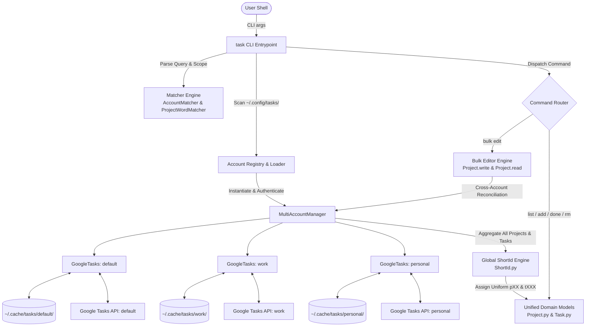
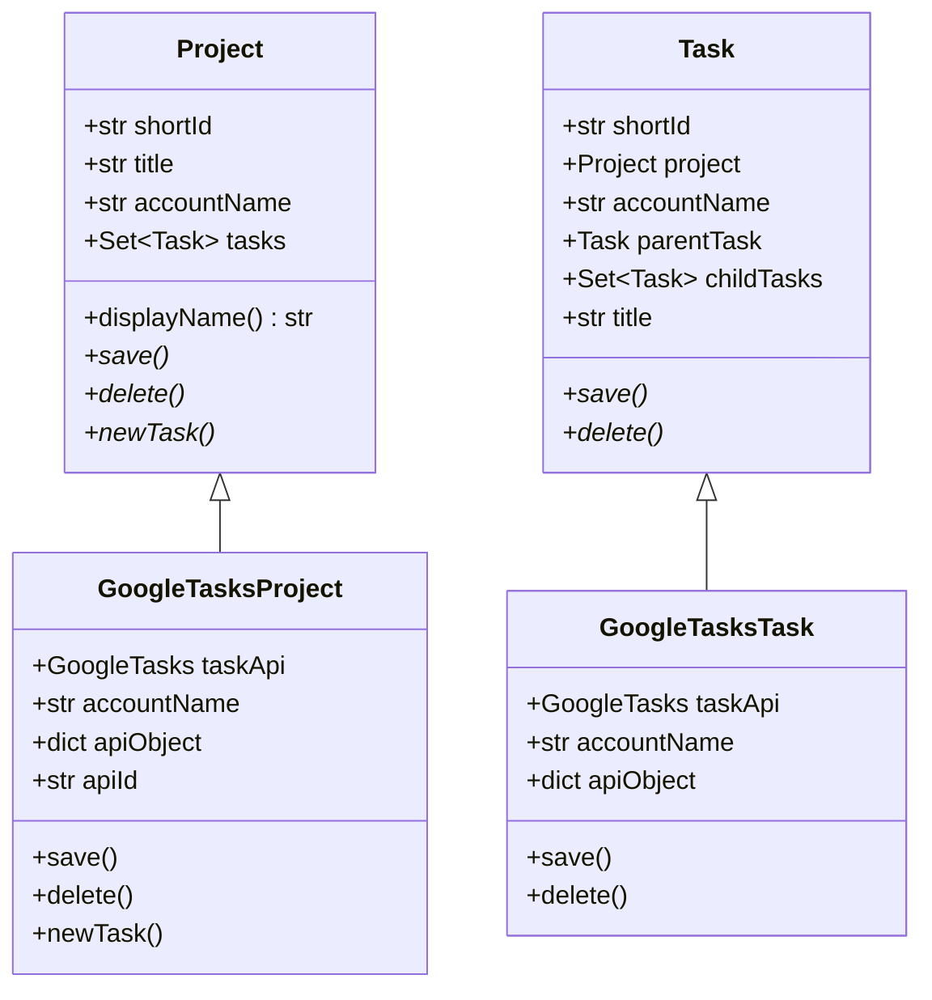
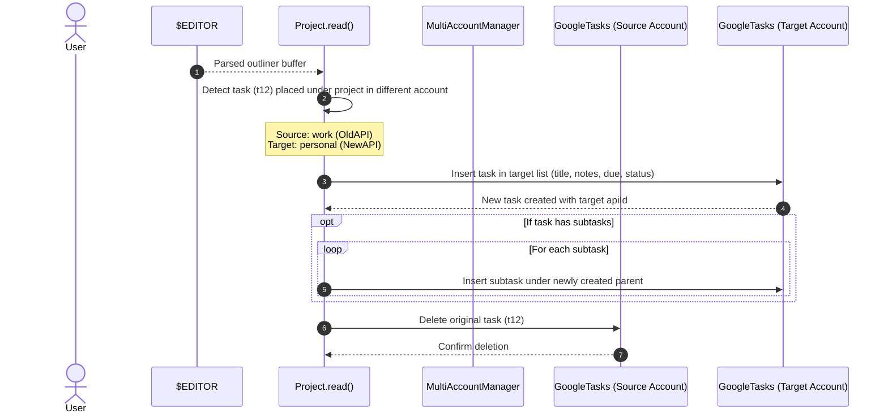

# Technical Design Document: Simultaneous Multi-Account Management

**Target Document**: `agentic/multi-account.md`  
**Reference Document**: `agentic/design.md`  
**Author / Architect**: Antigravity  
**Status**: Proposed / Approved for Implementation  
**Date**: November 2026  

---

## 1. Executive Summary & Objectives

### 1.1 Context & Motivation
The current `task` architecture supports multiple Google accounts, but operates strictly on a single account per invocation. The active account is determined by the `-A <account>` flag or falls back to an unsuffixed default account (`app-credentials.json` / `user-token.pickle`). 

In modern workflows, users frequently manage personal, work, and client commitments across multiple Google Task accounts. Requiring repeated invocations with `-A <account>` prevents unified task review (e.g. `task list due:today`), complicates GTD daily reviews, and makes moving tasks between contexts via interactive bulk editing impossible.

### 1.2 Core Objectives
This design modernizes `task` to manage **all installed accounts simultaneously** by default:
1. **Simultaneous Discovery & Load**: Auto-discover and authenticate all configured accounts on startup unless a single account is explicitly targeted with `-A <account>`.
2. **Clear Contextual Display**: Projects are displayed with an account prefix using colon notation (`<account>:<project>`, e.g. `work:Inbox`, `personal:Inbox`). Task listings inherit context naturally beneath project headers.
3. **Global Short ID Guarantee**: The dynamic Short ID engine (`ShortId.py`) assigns collision-free, uniform-length identifiers (`pXX`, `tXXX`) across all loaded accounts, allowing seamless operations (`task done t12`, `task rm t12`) without requiring account or project prefixes.
4. **Intuitive Task Capture**: Commands like `task add "Buy milk"` default to the default account's designated inbox unless an explicit account or project is specified.
5. **Cross-Account Bulk Editing (`task bulk`)**: Users can view, reorganize, and move tasks between accounts within a single interactive `$EDITOR` buffer.
6. **Backward Compatibility**: Existing command macros, configuration files, and flags (`-A <account>`) continue to function without disruption.

---

## 2. Requirements & Behavioral Specification

### 2.1 Account Discovery & Configuration

#### Filesystem Layout
Accounts are discovered dynamically from `~/.config/tasks/` based on Google OAuth credentials and client secrets:

```text
~/.config/tasks/
├── app-credentials.json          # Primary account OAuth2 client secrets (name: "default")
├── user-token.pickle             # Primary account user credentials
├── app-credentials.json.work     # Secondary account "work" client secrets
├── user-token.pickle.work        # Secondary account "work" user credentials
├── app-credentials.json.personal # Secondary account "personal" client secrets
├── user-token.pickle.personal    # Secondary account "personal" user credentials
├── default-account               # (Optional) Explicit name of default account
├── default-add-project           # Fallback project name for new tasks (e.g. "Inbox")
└── user-defined-commands         # Macro command aliases
```

#### Discovery Algorithm
1. Inspect directory `~/.config/tasks/` for files matching `app-credentials.json` or `app-credentials.json.<name>`.
2. Extract the account name:
   - File `app-credentials.json` maps to account name `"default"`.
   - File `app-credentials.json.<name>` maps to account name `"<name>"`.
3. If `~/.config/tasks/default-account` exists and contains a non-empty string, that string overrides `"default"` as the default account identifier.
4. If no accounts are found, raise a configuration error directing the user to initial setup documentation.
5. In multi-account mode, validate credentials and authenticate against all discovered accounts.

### 2.2 Account Scoping & CLI Overrides

| Invocation Mode | Mechanism | Behavior |
| :--- | :--- | :--- |
| **Simultaneous (Default)** | Standard CLI invocation (e.g. `task list`) | Loads and displays tasks and projects across all discovered accounts. Short IDs are globally unique across all accounts. |
| **Single-Account Override** | `-A <account>` CLI option | Restricts execution strictly to `<account>`. Projects omit the account prefix if desired or retain it for consistency. Useful for scripting or isolating workflows. |
| **Account Query Filter** | `a:<account>` or `account:<account>` | Filter AST matches projects and tasks belonging strictly to that account within a multi-account session. |
| **Project Account Scoping** | `p:<account>:<project>` | Scopes query to matching projects within a specific account. |

### 2.3 User Interaction & Presentation Format

#### Project Prefixing
In all user-facing output (`task list`, `task project-list`, `task bulk`), projects are prefixed with their account name:
```text
* (p01) work:Inbox
** (t1a) [ ] Submit Q4 budget proposal
** (t2b) [ ] [2026-11-05] Review pull requests

* (p02) personal:Inbox
** (t3c) [ ] Buy groceries
** (t4d) [ ] Schedule dentist appointment
```

- Standard delimiter: Colon (`<account>:<project>`).
- If an account is explicitly specified via `-A <account>`, output still adheres to standard formats (optionally showing `<account>:<project>` for consistency).
- Task titles do **not** repeat the account prefix; they inherit context from their enclosing project header.
- For individual task feedback messages (`task done t1a`, `task undo t1a`, `task rm t1a`), output prints the task line string directly, which unambiguously identifies the item via `t1a`.

### 2.4 Task & Project Creation & Disambiguation

#### Individual Task Creation (`task add`)
1. **No Project Specified**:
   - `task add "Buy coffee beans"`: Adds task to `default-add-project` (e.g., `Inbox`) within the **default account**.
2. **Unqualified Project Specified**:
   - `task add p:Inbox "Prepare agenda"`:
     - Check if multiple accounts have a project named `Inbox`.
     - When ambiguous, `task add` automatically resolves to the project in the **default account**.
3. **Qualified Project Specified**:
   - `task add p:work:Inbox "Prepare agenda"`: Adds task to `Inbox` within the `work` account.
4. **Account Specified via Flag**:
   - `task add -A personal "Renew gym membership"`: Scopes to `personal` account and adds to its default project.

#### Mutating Project Commands (`project-rename`, `project-delete`)
- If an unqualified name or regex matches projects in multiple accounts (e.g. `task project-rename Inbox WorkInbox`), the command **refuses to execute** and raises an `AmbiguousMatchError`:
  ```text
  error: 'Inbox' matches projects across multiple accounts:
    - work:Inbox (p01)
    - personal:Inbox (p02)
  Please qualify the project as '<account>:<project>' or specify by short ID (e.g. p01).
  ```

### 2.5 Short Identifier (`ShortId`) Uniqueness
- The Short ID engine collects **all** projects across all active accounts and assigns uniform prefixes `pXX`.
- The engine collects **all** tasks across all active accounts and assigns uniform prefixes `tXXX`.
- A single Trie index ensures that every task and project has a unique short ID across the entire multi-account dataset.
- Commands requiring an ID (`task done t1a`, `task delete t3c`, `task rename t2b "New title"`) resolve without ambiguity across all accounts.

### 2.6 Interactive Bulk Editing (`task bulk`)

#### Serialization Grammar
The bulk file serializes projects with their account prefix:
```text
# Interactive Task Outliner
* (p01) work:Inbox
** (t1a) [ ] [2026-11-05] Prepare status report
* (p02) personal:Inbox
** (t3c) [ ] Call plumber
```

#### Parsing & Cross-Account Moves
1. **Project Parsing**:
   - Lines matching `* (pXX) <account>:<title>` or `* (p) <account>:<title>`.
   - If a new project line omits `<account>:` (e.g. `* (p) Projects`), it is assigned to the default account.
2. **Cross-Account Task Migration**:
   - If a task `(t1a)` originally in `work:Inbox` is moved under `personal:Inbox`:
     - System detects account transition: `sourceAccount != targetAccount`.
     - System creates a new task in target account (`personal`) with matching title, notes, due date, completion status, and hierarchical structure.
     - System deletes the original task `(t1a)` from `work`.
     - Subtasks are migrated recursively to maintain hierarchy.
3. **Project Renaming vs Moving**:
   - Renaming `work:Inbox` to `work:LegacyInbox` updates the project title in `work`.
   - Changing the account prefix of an existing project (e.g. changing `* (p01) work:Inbox` to `* (p01) personal:Inbox`) is **disallowed**; project-level moves across accounts are not supported by Google Tasks API and will raise a `ParseError`.

---

## 3. High-Level Architecture

The architecture transitions from an isolated single-client model to a unified Multi-Account Controller orchestrating account-specific API adapters:



---

## 4. Component Design & Domain Model Updates

### 4.1 `MultiAccountManager` (`GoogleTasks.py` or new `AccountManager.py`)
Encapsulates all account adapters and provides a unified interface to the CLI and domain layer:

```python
class MultiAccountManager:
    """Manages multiple GoogleTasks adapter instances across accounts."""
    
    def __init__(self, configDir: str, cacheDir: str, activeAccount: str = None):
        self.configDir = configDir
        self.cacheDir = cacheDir
        self.activeAccount = activeAccount  # None = all accounts; str = single override
        self.accounts: dict[str, GoogleTasks] = {}
        self.defaultAccountName: str = "default"
        self._discoverAccounts()
        self._authenticateAll()

    def _discoverAccounts(self):
        """Scans configDir for app-credentials.json* and default-account."""
        ...

    def _authenticateAll(self):
        """Authenticates each active account adapter."""
        ...

    def getProjects(self) -> list[Project]:
        """Fetches and aggregates projects across all accounts with global ShortIds."""
        ...

    def newProject(self, accountName: str = None) -> Project:
        """Creates a new Project attached to the specified or default account."""
        ...

    def assignShortIds(self):
        """Recomputes global collision-free ShortIds across all accounts."""
        ...
```

### 4.2 Cache Architecture & Namespacing
To prevent collision of project or task IDs across accounts (such as `@default` lists or overlapping ID namespaces), disk caches are partitioned by account name:

```text
~/.cache/tasks/
├── default/
│   ├── project-<id>.pickle
│   └── tasks-<id>.pickle
├── work/
│   ├── project-<id>.pickle
│   └── tasks-<id>.pickle
└── personal/
    ├── project-<id>.pickle
    └── tasks-<id>.pickle
```

- Each `GoogleTasks` instance is initialized with `cacheDir = os.path.join(baseCacheDir, accountName)`.
- Existing caches in the root directory `~/.cache/tasks/*.pickle` are seamlessly migrated or invalidated.

### 4.3 Domain Model Extensions



#### Key Domain Attributes:
- **`Project.accountName`**: Name of the owning account (e.g. `"work"`, `"personal"`, `"default"`).
- **`Project.displayName`**: Formats title as `<accountName>:<title>` (e.g. `work:Inbox`).
- **`Project.__str__`**: Serializes as `* (pXX) <accountName>:<title>`.
- **`Task.accountName`**: Convenience accessor returning `self.project.accountName`.

### 4.4 Global Short Identifier Trie Engine
In single-account mode, `updateShortIds` was invoked on local project sets or local task sets. In multi-account mode:
1. `MultiAccountManager.getProjects()` collects all `Project` instances across all accounts.
2. `ShortId.updateShortIds(allProjects, "p")` runs once across the aggregated project list.
3. When tasks are loaded (`project.tasks`), tasks are added to a centralized pool in `MultiAccountManager.allTasks`.
4. `ShortId.updateShortIds(allTasks, "t")` runs across the union of all tasks from all accounts.
5. **Fixed Length Invariant**: All projects in a run share the same length `fixedLen`, and all tasks share a uniform `fixedLen`. Every short ID is globally unambiguous across all accounts.

### 4.5 Query Engine & Matcher Extensions

#### New `AccountMatcher` (`Matcher.py` / `Task.py` / `Project.py`)
Matches projects and tasks belonging to a specific account:
```python
class AccountMatcher(Matcher.Matcher):
    def __init__(self, accountName: str):
        super().__init__()
        self.accountName = accountName

    def match(self, projectOrTask) -> bool:
        itemAccount = getattr(projectOrTask, "accountName", None)
        if itemAccount is None and hasattr(projectOrTask, "project"):
            itemAccount = projectOrTask.project.accountName
        return itemAccount.lower() == self.accountName.lower()
```

#### Enhanced `ProjectWordMatcher`
Supports composite account syntax:
- `p:work:Inbox` $\rightarrow$ Matches `account == "work"` AND `title == "Inbox"`.
- `p:Inbox` $\rightarrow$ Matches any project with title `"Inbox"` across any account.
- `a:work` or `account:work` $\rightarrow$ Matched via `AccountMatcher("work")`.

### 4.6 Interactive Bulk Editing & Cross-Account Move Reconciliation



#### Reconciliation Details:
1. When parsing projects:
   `* (p01) <account>:<title>`
   The parser verifies that `shortId` `p01` belongs to `<account>`. Renaming the title is allowed; altering the account raises a `ParseError`.
2. When parsing new projects:
   `* (p) <account>:<title>`
   The parser invokes `MAM.newProject(accountName)`.
3. When moving tasks across accounts:
   - Since Google Tasks REST API does not allow moving tasks between accounts (nor between different tasklists), a cross-account move is executed as **Deep Copy + Delete**.
   - Recursive copy preserves subtask trees and sibling ordering where possible.
   - Deletion of the source task occurs only after the target task insertion succeeds.

---

## 5. Implementation Plan & File Modifications

### 5.1 `GoogleTasks.py`
- Modify `GoogleTasks.__init__` to accept `accountName: str = "default"`.
- Update `cacheDir` configuration to use account subdirectories (`os.path.join(cacheDir, accountName)`).
- Update `GoogleTasks.Project` and `GoogleTasks.Task` to store and expose `accountName`.
- Add `MultiAccountManager` class managing discovery, authentication, caching, and unified project/task queries.

### 5.2 `ShortId.py`
- Retain existing Trie logic; ensure `updateShortIds` can process arbitrary iterables containing objects from multiple accounts without modification.

### 5.3 `Matcher.py`
- Add `AccountMatcher` base class.
- Extend CLI parsing for tokens matching `a:<acct>` or `account:<acct>`.

### 5.4 `Project.py`
- Update `Project.__init__` to accept `accountName`.
- Update `__str__` to output `* (pXX) <accountName>:<title>`.
- Update `Project.parse()` regex to match both `* (pXX) <account>:<title>` and legacy `* (pXX) <title>`.
- Update `Project.sort()`:
  - Sort primary by account (default account first, followed alphabetically by account name).
  - Sort secondary by project priority (`Scheduled` $\rightarrow$ `Inbox` $\rightarrow$ alphabetical).
- Update `Project.read()`:
  - Track source and target account for every task.
  - Implement cross-account migration logic.
  - Disallow changing a project's account prefix.

### 5.5 `Task.py`
- Add `accountName` property delegating to `self.project.accountName`.
- In `Task.set_project()`, track if project assignment spans different accounts.

### 5.6 `task` (CLI Controller)
- Replace single `taskApi = GoogleTasks(...)` with `accountManager = MultiAccountManager(...)`.
- Update `getMatchingProjects()` and `getMatchingTasks()` to operate across `accountManager`.
- Update `doTaskAdd()`:
  - If project is not explicitly specified, retrieve `default-add-project` from the default account.
  - If project is specified without account, search in default account first if ambiguous.
- Update `doProjectRename()` / `doProjectDelete()` to require explicit qualification if matches are ambiguous.
- Update `doTasksBulk()` to pass `accountManager` to `Project.read()` and `Project.write()`.

---

## 6. Comprehensive Testing Plan

### 6.1 Unit Test Coverage (`tests/test_multi_account.py`)

1. **Account Discovery & Default Resolution**:
   - Verify discovery of single unsuffixed `app-credentials.json` as `"default"`.
   - Verify discovery of multiple `app-credentials.json.<acct>` files.
   - Verify override from `~/.config/tasks/default-account`.
   - Verify handling when no credentials exist.

2. **Short ID Collision & Uniqueness**:
   - Create mock tasks and projects across 3 separate accounts.
   - Generate short IDs through the unified manager.
   - Assert all project short IDs start with `p`, are unique, and have identical string lengths.
   - Assert all task short IDs start with `t`, are unique, and have identical string lengths.

3. **Query Matching AST**:
   - Test `a:work` matches only `work` projects and tasks.
   - Test `p:work:Inbox` matches `work:Inbox` and excludes `personal:Inbox`.
   - Test `p:Inbox` matches both `work:Inbox` and `personal:Inbox`.
   - Test boolean combinations: `a:work due:today OR a:personal @urgent`.

4. **Project Parsing & Formatting**:
   - Verify `Project.parse("* (p01) work:Inbox")` extracts account `"work"`, shortId `"p01"`, and title `"Inbox"`.
   - Verify `Project.parse("* (p) personal:Chores")` extracts account `"personal"` and title `"Chores"`.
   - Verify legacy lines `* (p01) Inbox` fall back to default account.

### 6.2 Bulk Edit & Cross-Account Move Tests (`tests/test_bulk_multi_account.py`)

1. **In-Buffer Representation**:
   - Serialize projects from multiple accounts; assert headers include `<account>:<project>`.
2. **Cross-Account Task Move**:
   - Simulate outliner edit moving `(t1a)` from `work:Inbox` to `personal:Inbox`.
   - Execute `Project.read()`.
   - Assert `targetApi.insertTask` is called with identical task metadata.
   - Assert `sourceApi.deleteTask` is called for `(t1a)`.
3. **Subtask Hierarchy Preservation Across Accounts**:
   - Move a parent task with 2 subtasks across accounts.
   - Assert target account creates parent first, then subtasks with correct `parent` pointer.
   - Assert source account deletes the original hierarchy.
4. **Error Handling**:
   - Test modifying project account prefix `* (p01) work:Inbox` $\rightarrow$ `* (p01) personal:Inbox`.
   - Assert `ParseError` is raised with informative error message.

### 6.3 End-to-End CLI Scenarios (`tests/test_cli_scenarios.py`)

1. **Unified Listing**:
   - Run `task list`: displays projects from both accounts in sorted order.
2. **Individual Action Without Project / Account**:
   - Run `task done t12`: marks task done in its respective account without prompting for account.
3. **Ambiguity Handling**:
   - Run `task add p:Inbox "New task"` when `Inbox` exists in both accounts: resolves cleanly to default account.
   - Run `task project-rename Inbox WorkInbox`: detects ambiguity and aborts with helpful error.

---

## 7. Edge Cases & Resilience

| Edge Case | Failure Mode | Mitigation / Resolution |
| :--- | :--- | :--- |
| **Partial Auth Failure** | One account's refresh token expired; others valid. | Attempt browser re-auth for expired account. If running headless or user cancels, warn to `stderr` and continue with remaining valid accounts, flagging unavailable account. |
| **Network Failure During Cross-Account Move** | Target task created, but source deletion fails (or vice versa). | Create target task first. If creation fails, abort before source deletion. If source deletion fails after target creation, log explicit warning with task ID to avoid data loss. |
| **Identical Project Names** | Both accounts have `Inbox`, `Admin`, or `Scheduled`. | Display with `<account>:` prefix. Disambiguate `task add` using default account; require `p:<acct>:<name>` for project modifications. |
| **Default Account Missing** | `default-account` specifies an account not present in config. | Raise configuration error listing all discovered accounts. |
| **Cache Corruption** | One account's cache is invalid or corrupt. | Cache partitioning ensures an issue in one account's cache does not invalidate or affect other accounts. |

---

## 8. Rollout & Migration Guide

1. **Automatic Cache Migration**:
   - On first run of updated version, existing `~/.cache/tasks/project-*.pickle` files are moved into `~/.cache/tasks/default/` or cleared safely.
2. **Backward Compatible Configuration**:
   - Existing single-account setups with `app-credentials.json` require zero changes; the account will be assigned name `"default"`.
   - Users with existing `-A <acct>` scripts and configurations can continue using `-A <acct>` unchanged.
3. **Adopting Multi-Account**:
   - Users add secondary accounts by copying client secrets to `~/.config/tasks/app-credentials.json.<name>`.
   - On first run, the tool triggers OAuth authorization for the new account and writes `~/.config/tasks/user-token.pickle.<name>`.
   - Multi-account operations become active immediately.
